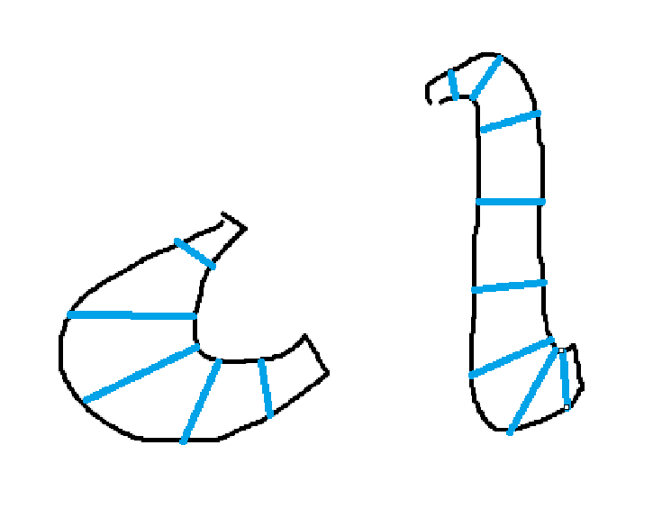

# Fontra thickness heatmap

A [Fontra](https://fontra.xyz) plugin that turns stroke-weight variation into a
readable heatmap. It compares the **actual outline thickness** of the glyph you
are editing with a **Noordzij-style pen model**, and shows where the drawing is
lighter, heavier, or close to the model.

The point is not to “correct” optical work. Bowls, spines, junctions, and
terminals are often deliberately off-model. The heatmap is a lens for seeing
the pattern, not a linter.


## Install

In Fontra’s plugin manager, add this GitHub repository as a plugin:

```
Reponja/Fontra-thickness-heatmap
```

Then confirm the installation. A **Thickness heatmap** panel appears in the
right sidebar, and a visualization layer with the same name is enabled for the
glyph being edited. The overlay can also be switched off from Fontra’s
appearance menu without closing the panel.

The panel’s **Show thickness heatmap** checkbox is the main on/off switch. It
turns off analysis and drawing completely while keeping the panel and all of
your settings available. The choice is remembered between Fontra sessions. The
same state is reflected in Fontra’s appearance menu, so either switch keeps the
other one in sync.

Plugins stay installed from GitHub. If Fontra keeps loading an older copy after
you push an update, that is jsDelivr’s cache, not a broken install. Run
`tools\purge-jsdelivr.cmd` after pushing. It gives each plugin a semver release
tag (required, because jsDelivr cannot purge branch-based `@latest`), purges all
your local plugin repositories, and then reload Fontra. See
[tools/README.md](tools/README.md).

The plugin is self-contained: it does not import Fontra’s internal modules.
Fontra’s built client ships webpack bundles, so paths such as
`/editor/visualization-layer-definitions.js` do not exist on the server. A
plugin that imports `fontra/...` gets a 404 that the browser reports as a
disallowed MIME type (`text/plain`). This plugin talks to the editor through
the controller API instead, so it works with bundled Fontra builds, including
Fontra Pak.

If Fontra still runs an older copy after an update, push first, then run
`tools\purge-jsdelivr.cmd`. It tags the pushed commit as a semver release,
purges the release tag and refreshes the `@latest` alias on jsDelivr for all
your plugins, and verifies the result. If a plugin still looks old in Fontra,
use DevTools’ “Disable cache” reload.

## How to read the map

- **Cool / blue** — the drawing is thinner than the model at that point.
- **Warm / orange or red** — the drawing is thicker than the model.
- **Neutral / faded** — the deviation is inside the tolerance band, or the
  measurement is low-confidence.
- **Low-confidence areas** — stroke ends, sharp corners, junctions, serifs, and
  hairlines. In the deviation and outliers views they are faded rather than
  treated as evidence of a mistake. The **model target** and **measured**
  views are absolute readouts, so they show the nearest reliable measurement
  in every inked pixel instead of leaving gaps.

The default **tolerance band is ±5%**. Raise it if intentional optical
corrections are dominating the map. The **glyph summary** reports the median
measured thickness, model target, deviation range, and how much of the contour
falls inside the tolerance.

### Per-element measurement

By default the plugin measures the glyph as one filled shape, so overlapping
contours share their junction. Enable **Measure each element separately** in the
**Elements** section when a letter is assembled from separate contours or
components — for example an `i` dot, a `B` built from a stem and two bowls, or
a component-based `é`. Each contour or component is rasterized and measured on
its own, so a stem's measurement cannot leak into an adjacent bowl.

- Counters and holes stay part of their parent element and are cut out before
  measurement.
- An island inside a counter is its own element.
- Overlapping contours remain separate elements; they are not treated as holes.
- A letter drawn as a single contour is still one element, so its junctions are
  measured together. Per-element mode cannot separate subpaths that were joined
  into one contour.
- Components are measured in their transformed position; a component with a
  counter keeps its hole.

Use **Show** to choose **All elements**, **Selected element(s)**, or **Hovered
element**. With a focused selection, other elements are faded to 12% opacity, or
hidden when **Fade other elements** is off. Selection focus follows point and
component selection in the glyph editor; hover focus follows the pointer,
including components. The panel summary and the color range still use all
measured elements, so colors remain comparable when you switch focus.

Per-element mode is optional because it runs one analysis per element. Complex
glyphs with many contours take longer, especially with careful measurement on;
use a lower **Analysis detail** setting if it feels sluggish.

## Flow guides

You can draw guide lines over the glyph to tell the measurement which way a
stroke flows. This is useful where the outline alone is ambiguous: a junction,
a curved bowl, a flared terminal, or a serif.



- In the **Flow guides** section, press **Draw guides**.
- Drag across a stroke. The plugin measures the ink span along the line and
  uses the perpendicular as the local stroke direction. The blue line is a
  manual caliper, not part of the glyph.
- Hold **Shift** for a straight line. Press **Esc** when you are done drawing.
- **Guide line → Along the stroke** switches the interpretation: the line's own
  direction becomes the flow instead of its perpendicular. Draw down the middle
  of a stroke in that mode.
- **Use guides in measurement** applies the guides to the pen model. Turn it
  off to compare the same glyph without them.
- **Show guides** controls only the blue overlay, so hidden guides can still be
  active.
- **Undo guide** removes the last line on the glyph. **Clear glyph** removes all
  of them.

Guide influence fades out away from each line, so an isolated guide affects its
local stroke rather than repainting the whole glyph. Draw as many lines as the
shape needs. In across-stroke mode a guide also supplies a manual thickness
reading, which is useful when the automatic caliper is unsure at a terminal or
junction. Guides are stored in this browser per glyph; they are not written into
the font file. Undo/redo in Fontra does not include guide edits.

## Pen models

All three models use the vertical stem as the reference thickness. For
translation and monoline, the **Vertical thickness** value is the target for a
vertical stem and every other direction is predicted relative to it. Expansion
also has an explicit **Horizontal thickness**, because expansion is about how
thick your vertical and horizontal strokes are, not about a pen angle.

### Translation (broad nib)

A broad nib held at a fixed angle. The nib angle selects the thin direction;
the stroke gets thicker as it turns toward the nib’s broad axis.

```
f(τ) = m + (1 − m) · |sin(θ − τ)| / |sin(θ − 90°)|
```

- `θ` is the **pen angle**.
- `m` is the **pen-edge thickness** as a fraction of the vertical target.
- `τ` is the local stroke direction, taken from the outline tangent.

The pen edge is defined the way a designer thinks about it: with a 100-unit
vertical target and a 20% pen edge, the thinnest stroke is 20 units. The slider
stops at 100% (a square nib, which gives a monoline result), but the numeric
field accepts higher values. Above 100% the contrast reverses: the direction
parallel to the nib edge becomes thicker than the vertical stem.

With a sharp nib (`m = 0`), a 30° pen angle predicts horizontal strokes at
about 58% of the vertical stem thickness. The default 8% pen edge raises that
to about 61%.

### Expansion (pointed pen)

A pointed pen changes width through pressure rather than a fixed nib angle.
The model therefore takes the two thicknesses a designer actually decides on:
how thick vertical strokes are, and how thick horizontal strokes are.

```
T(τ) = H + (V − H)·sin²τ
f(τ) = T(τ) / V
```

- `V` is the **Vertical thickness** — the target for vertical stems.
- `H` is the **Horizontal thickness** — the target for horizontal strokes.
- `τ` is the local stroke direction; 90° is vertical, 0° is horizontal.

The `sin²` blend keeps the transition smooth and reaches both targets exactly.
With `V = 100` and `H = 25`, a horizontal stroke is predicted at 25 units and a
45° diagonal at 62.5 units. `H` may be larger than `V` if the design has
reverse contrast.

### Monoline

Uses the same target in every direction. Useful for checking whether optical
weight changes are consistent, or as a neutral reference.

## Measurement method

The plugin rasterizes the glyph’s live `flattenedPath2d` at the selected
analysis detail, so components, overlaps, and counters are handled by the
ordinary fill rule. In per-element mode it rasterizes each grouped contour or
component into a padded crop instead, and runs the same pipeline with a shared
blur radius and a shared color range. The crops overlap only for display; each
element’s measurements are computed from its own mask.

1. Build a binary ink mask with a small margin, then blur it into a coverage
   field.
2. Find the boundary and compute an exact Euclidean distance transform.
3. At each boundary pixel, derive the inward normal from the coverage-field
   gradient and march inward until the opposite edge.
4. Treat the two opposite edges as a caliper measurement. The local stroke
   direction is the tangent perpendicular to that caliper. Validate the caliper
   with the normal at the opposite edge and with the distance to the medial
   axis; rays that run along a stroke end rather than across it are marked
   low-confidence.
5. In **careful mode**, trace the same stroke back from the opposite edge. A
   real caliper returns to its starting point with a similar width; a chord
   across a curve or a junction does not. The two widths are averaged to get
   the middle ground between the left and right sides of the stroke. Mismatched
   traces are faded instead of becoming false hot spots.
6. Smooth boundary samples spatially and fade sharp turns, which are usually
   junctions, terminals, or corners. Careful mode uses a wider corner window so
   a junction is recognized even when its normals turn gradually over a few
   pixels.
7. Propagate widths from the nearest **confident** boundary sample, so an
   ambiguous junction cannot paint a fan of wrong values into the stroke
   interior. A sample may only reach pixels inside its inward-normal wedge and
   on a compatible stroke direction, so a confident edge on one side of a
   junction cannot bleed into the neighbouring stroke. Low-confidence samples
   still drive the fade field in the deviation views. The absolute target and
   measured views use the same propagated values and fall back to the nearest
   raw sample only where no confident sample exists.
8. Smooth the width field, and smooth stroke direction as a doubled-angle
   vector field. The model target is derived from that smoothed direction, so
   the target and deviation fields vary continuously across curves.
9. If flow guides are present, build a nearest-guide field with a smooth local
   falloff. In across-stroke mode, the guide's ink span supplies a manual
   caliper width, and its perpendicular supplies the flow direction. In
   along-stroke mode, only the direction is taken from the line. Manual guides
   take precedence over the inferred field near the line and hand back to it
   with distance.
10. Render the selected display mode.

A cached analysis keyed by the path and model settings keeps normal editing
interactive. Cosmetic changes such as overlay opacity or display mode reuse the
same analysis.

## Controls

- **Model** — translation, expansion, or monoline.
- **Show thickness heatmap** — turn the overlay and all measurement on or off.
  The setting is remembered and stays in sync with Fontra’s appearance menu.
- **Vertical thickness** — target for vertical stems, in font units.
- **Horizontal thickness** — target for horizontal strokes in the expansion
  model. Diagonal targets blend smoothly between the two.
- **Pen edge thickness** — thinnest stroke as a percentage of the vertical
  target. The slider stops at 100%; type a higher number for inverted contrast.
  The panel shows the computed thinnest thickness in font units.
- **Fit to glyph** — estimates vertical and horizontal targets from the current
  outline using medians, so one odd terminal does not decide the result.
- **Show** — deviation, model target, measured thickness, or outliers only.
- **Deviation colors** — blue/orange (colorblind-friendly) or classic blue/red.
- **Color scale** — the deviation mapped to the strongest color.
- **Tolerance band** — deviations inside this band remain faint and neutral in
  the deviation and outliers views. It has no effect on the absolute target and
  measured views, so the control is hidden there.
- **Overlay opacity** — how strongly the heatmap covers the glyph.
- **Analysis detail** — raster resolution: fast, balanced, or fine.
- **Fade low-confidence areas** — fades junctions, serifs, caps, and hairlines
  in the deviation and outliers views. It is disabled in the absolute target
  and measured views, where every inked pixel shows its nearest reliable
  measurement.
- **Careful curve & junction measurement** — traces strokes from both sides and
  rejects chords across curves and junctions. Slower; turn it off for a quick
  read.
- **Measure each element separately** — analyze every contour and component on
  its own. Off by default; see [Per-element measurement](#per-element-measurement).
- **Elements → Show** — with per-element mode, choose all elements, selected
  element(s), or the hovered element.
- **Fade other elements** — keep non-focused elements visible at 12% opacity;
  turn off to hide them entirely.
- **Flow guides → Draw guides** — draw guide lines on the current glyph.
  Hold Shift for a straight guide; Esc finishes drawing.
- **Flow guides → Guide line** — treat a guide as a cross-section (**Across the
  stroke**, the default) or as a centreline (**Along the stroke**).
- **Flow guides → Use guides in measurement** — include or ignore the guides in
  the analysis without deleting them.
- **Flow guides → Show guides** — show or hide the blue overlay independently of
  whether the guides affect the measurement.
- **Flow guides → Undo guide / Clear glyph** — remove the last guide or all
  guides from the current glyph.

## Scope and limitations

- The heatmap analyzes the **currently editing glyph** only. A font-wide audit
  is not part of this version.
- Variable fonts are measured at the current instance location.
- Thickness is measured perpendicular to the outline. Very sharp terminals,
  overlapping strokes, and hairline details can produce ambiguous local
  measurements; the confidence fade is there to keep those from driving the
  statistics in the deviation views. The absolute views still show the nearest
  reliable value, and use the nearest raw sample only when a region has no
  confident measurement at all. Careful mode reduces false chords at curves and
  junctions, but it cannot make an intentionally off-model stroke look on-model.
- Contrast letters such as **V** often have a deliberately thinner right side.
  That will still show as a deviation from a symmetric pen model; it is a
  property of the design, not a measurement failure.
- There is no automatic outline correction and no recommendation engine. The
  map is diagnostic.
- Latin-style outlines are the initial focus; CJK and highly complex
  calligraphic structures may need tuning of the detail level and confidence
  threshold.
- Per-element grouping is topology-based. A self-intersecting contour, a
  same-winding nested contour, or subpaths joined into a single contour are
  treated conservatively: they are not split into separate shapes. If a letter
  must be separated at a junction, split the outline into contours or
  components first.
- Per-element mode runs one analysis per element, so glyphs with many contours
  take longer than whole-glyph mode, particularly with careful measurement on.
- Flow guides are stored in the browser's local storage per glyph name, not in
  the font. They are not shared between machines and do not participate in
  Fontra's undo/redo. A guide drawn in across-stroke mode is a manual
  measurement: if it is aimed along a stroke instead of across it, the long
  chord will become a thick manual reading. Switch to **Along the stroke** for
  centreline guides.

## Development

The core measurement and model code is plain JavaScript with no browser
dependencies, so it can be tested with Node:

```sh
npm test
```

To preview the rendering pipeline without Fontra, serve the repository and open
the standalone demo:

```sh
python -m http.server 8000
# then open http://localhost:8000/demo/
```

The demo rasterizes browser text and runs the same pure analysis and color
mapping code as the plugin. It is intended for quick visual checks and for
developing the color maps.

### Files

- `start.js` — registers the sidebar panel and visualization layer.
- `src/core.js` — model math, masks, distance transforms, caliper measurement,
  confidence, and statistics.
- `src/colormap.js` — diverging/sequential color maps, legends, and RGBA output.
- `src/elements.js` — contour flattening, winding/containment analysis, and
  per-element grouping for components and counters.
- `src/engine.js` — browser rasterization, per-element crops and compositing,
  caching, and Fontra-facing analysis.
- `src/guides.js` — flow-guide normalization, simplification, fingerprints, and
  browser-local persistence.
- `src/panel.js` — the sidebar controls, guide drawing, legend, and glyph
  summary.
- `src/ui.js` — self-contained UI primitives (panel base, DOM helpers, and
  settings persistence) so the plugin does not depend on Fontra’s internal
  module paths.
- `demo/` — standalone browser preview.
- `test/` — Node tests for model math, synthetic masks, contour grouping, and
  the per-element engine/canvas pipeline.

## License

See [LICENSE](LICENSE).
